# Wasel UI — Transit Instrument

## Source of inspiration

The visual system takes its discipline from [KiroCrew](https://github.com/kirodotdev/KiroCrew) (Apache-2.0), a React + Vite + Tailwind dashboard. We borrow the **system**, not the components:

| KiroCrew | Wasel |
|---|---|
| Near-black layered surfaces, one mint accent | Night Route; one teal accent used only for the next move |
| Semantic CSS tokens, no raw hex in components | `themes.json` + typed `Theme`; no raw hex outside it |
| "Sovereign vs transient" density rule | Guidance is the most transient surface: one instruction, three actions |
| Visible agent execution | Planning timeline; dev drawer for tool calls |
| Glass composer dock | Bottom action dock, opaque fallback |
| 14 themes + theme packs | Two accessibility themes, not a marketplace |
| 14px base, Space Grotesk | 17px minimum, IBM Plex Sans Arabic |
| Dense three-pane desktop shell | One screen, one decision; map lives in a sheet |
| Focus ring, aria-live, reduced motion, 44px targets | RN equivalents: labels, announcements, reduce-motion, 48/64px targets |

We do not copy Kiro's logo, brand art, or screenshots. The Apache-2.0 licence would allow code reuse, but their components are React DOM; ours are React Native. Borrowing the rules is faster and safer.

## Principles

1. **One accent, one meaning.** Teal means "the next move" or "the primary action." Nothing else.
2. **One screen, one decision.** Guidance has Repeat, Map, End. Everything else is a sheet.
3. **The sign, not the map.** The main guidance surface is a transit sign: huge arrow, distance, street, next step. The real map is secondary.
4. **Theme is a profile.** Blind/low-vision defaults to Night Route; Deaf/HoH defaults to Daylight. Both use the same cherry-red accent.
5. **Flat fills, visible edges.** No decorative gradients on chrome. Every card carries a border or a shadow.
6. **Motion has a job.** A new cue rises 8px in 280ms. Alert pulses once. Reduce-motion makes it instant.
7. **Color never carries meaning alone.** Every cue also has text, an icon, and a haptic.

## Themes

`apps/mobile/src/ui/themes.json` is the source of truth.

| Role | Night Route | Daylight |
|---|---|---|
| `bg` | `#0D1117` | `#F6F7F9` |
| `surface` | `#151B23` | `#FFFFFF` |
| `surfaceRaised` | `#1C2430` | `#FFFFFF` |
| `border` | `#334155` | `#D4DCE6` |
| `text` | `#F1F5F9` | `#0B1220` |
| `textMuted` | `#A8B6C6` | `#4A5568` |
| `accent` | `#D2042D` | `#B0002A` |
| `accentInk` | `#FFFFFF` | `#FFFFFF` |
| `accentText` | `#FF6B81` | `#B0002A` |
| `warn` | `#FBBF24` | `#B45309` |
| `danger` | `#FB7185` | `#B91C1C` |
| `info` | `#60A5FA` | `#1D4ED8` |

Night uses a deep cherry fill with white ink and a lighter cherry (`accentText`) for small text on dark surfaces. Daylight uses deep cherry with white ink. Backgrounds and surfaces are unchanged.

`node scripts/check-contrast.mjs` is the gate. It checks body text at 4.5:1, solid button labels at 4.5:1, accent/warn/danger UI edges at 3:1, and card edge visibility. Fix the token, not the test.

## Typography

- **Latin + Arabic:** IBM Plex Sans Arabic (OFL). Regular 400, Medium 500, SemiBold 600, Bold 700.
- **Numbers:** IBM Plex Mono Medium/SemiBold, tabular.
- **Scale:** display 52, distance 40, title 30, h2 22, body 17, label 15, caption 13.
- **Rules:** body never below 17; caption only for metadata; Arabic line-height 1.6; no letter-spacing in Arabic; no uppercase.
- **Scaling:** user setting 100/125/150/200%; test 200% on a 320px-wide screen.

## Shape and spacing

- 4pt base. Screen gutter 20. Card padding 20. Primary control 64 high; minimum target 48.
- Radii: 12 small, 16 card/button, 24 sheet, 999 pill.
- Night and Daylight use 1px borders.
- Shadows only on cards and the bottom dock.

## Screens

### Home

Brand + language toggle + settings. A 36px headline, a profile segmented control, a 94px mic orb, an always-available text field, four quick places with distance, optional recent route, and a setup card. Bottom tabs: Home, Converse, Settings.

### Plan

A transient surface, spacious. "Heard you" card with the raw request, then a visible agent timeline:

1. Heard you
2. Finding the destination
3. Route ready
4. Preparing guidance

Rows stagger in at 80ms. Failure turns the active row red and offers Retry + Use demo route.

### Guide

```
┌──────────────────────────────┐
│ X   4 min · 300 m     [Demo] │
│                              │
│            ↰                 │
│         Turn left            │
│          in 30 m             │
│   onto University Road       │
│                              │
│  Next: continue 40 m         │
│  ●━━━━━━●━━━━━━○             │
│                              │
│   [Repeat] [Map] [Hold end]  │
└──────────────────────────────┘
```

- No map on the main screen. A schematic progress rail + instruction stage.
- Metrics top, mode chip (Demo/GPS), close X.
- Bottom dock: Repeat, Map, End (press opens confirmation; long-press ends).
- Arrival becomes a full-screen "You have arrived" card.
- The map sheet contains a schematic route sketch, distance/ETA/provider, and the cue list.

### Bus

A destination search with quick Amman chips, a persistent demo-data banner, and itinerary cards. Each card shows total time, transfer count, walk legs, a line badge, board/alight stops, a next-bus countdown, and a simulated occupancy chip. The trip status reads `Simulated` in demo mode, `Estimated` for Google estimates, and `Live` only when a real-time feed exists. Google mode adds a `Transit data from Google` line.

Occupancy is never presented as real unless the source is an operator or a rider report. The demo uses `8 seats left / Standing / Full` with a `Simulated` label.

### Converse

Visual-first. A large live-caption card, quick phrases, a text field, a mic button for the other person, and a demo-reply link. Sending a phrase speaks it aloud through the phone. Captions are 20px with 1.45 line-height.

### Settings

Section cards: Profile, Language, Theme (Auto/Night/Day/Contrast), Text size, Voice speed, Haptics (switch + test legend), Navigation preferences, Safety, About. The About card exposes the API URL, version, and a backend test.

### Onboarding

Four chapters: welcome + safety, profile, language + theme, test voice + haptics. Progress dots, skip, one idea per screen. The last screen offers a sample cue and a start button.

## Components

`Screen`, `Card`, `Button`, `IconButton`, `SegmentedControl`, `SettingsRow`, `Header`, `InstructionStage`, `ManeuverArrow`, `ProgressRail`, `AgentPlan`, `BottomDock`, `Sheet`, `LiveCaptions`, `RouteSketch`, `ErrorNotice`, `HapticLegend`, `BrandMark`, `TabBar`.

Build the first eight before adding more surface area.

## Motion

| Motion | Spec |
|---|---|
| Cue entrance | opacity 0→1, translateY 8→0, 280ms `cubic-bezier(.16,1,.3,1)` |
| Plan row | 320ms, 80ms stagger |
| Sheet | native slide; `none` under reduce-motion |
| Alert | one 600ms pulse; never loop |
| Route draw | static; no animated dash |

Reduce-motion is read from the system and can be forced in preferences. No ambient background animation: the washes are static, like KiroCrew's.

## Haptics grammar

| Pattern | Android | Meaning |
|---|---|---|
| `left` | one 70ms pulse | Turn left |
| `right` | two pulses | Turn right |
| `arrive` | three rising pulses | Arrived |
| `warn` | two long buzzes | Wrong way / hazard |
| `tick` | 35ms | Departure / minor confirmation |

iOS uses notification/impact haptics in Phase 0; custom Core Haptics patterns need a native module in Phase 1. The app says this in the settings test legend.

## Urgency

- **Normal:** accent, one haptic, full sentence.
- **Imminent (≤10m):** warning amber, double haptic, shorter phrase ("Right now").
- **Critical:** danger rose, long buzz, interrupt speech, optional screen flash.

Color is always paired with icon, text, and haptic.

## RTL and Arabic

- Use `marginStart/End`, `paddingStart/End`, and a direction context.
- Mirror layout and chevrons; **never mirror maneuver arrows** — "turn left" is physical.
- Arabic line-height 1.6; no letter-spacing; no uppercase.
- Test text expansion at 200%; Arabic strings can be 20–30% longer.
- Western digits by default for distances; Arabic-Indic digits are a future setting.

## Screen reader + TTS

Detect `AccessibilityInfo.isScreenReaderEnabled()`. If a screen reader is active, do not use `expo-speech` for cues; call `AccessibilityInfo.announceForAccessibility` so TalkBack/VoiceOver does not double-speak. Do not set live regions on rapidly changing distance text — announce the instruction, not the countdown.

## Screenshots

Captured from the web build at 390×844. The native build uses the same components and tokens.

| Home — Night Route | Home — Daylight | Home — Arabic |
|---|---|---|
| 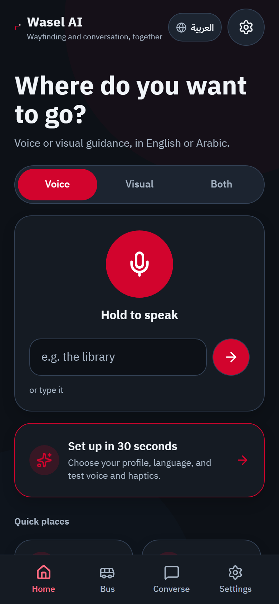 | 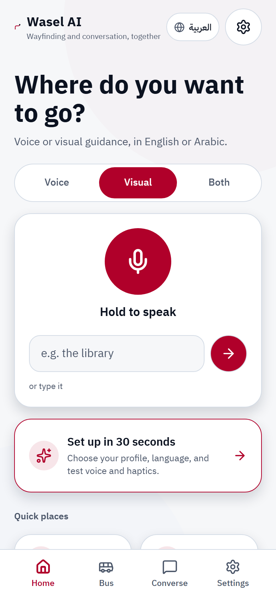 | 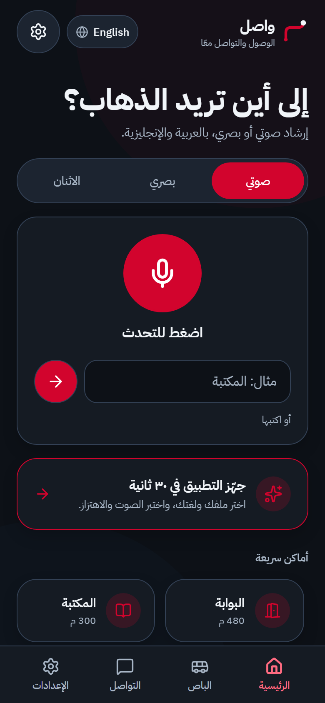 |

| Guide — Night Route | Guide — Daylight | Guide — Arabic |
|---|---|---|
| 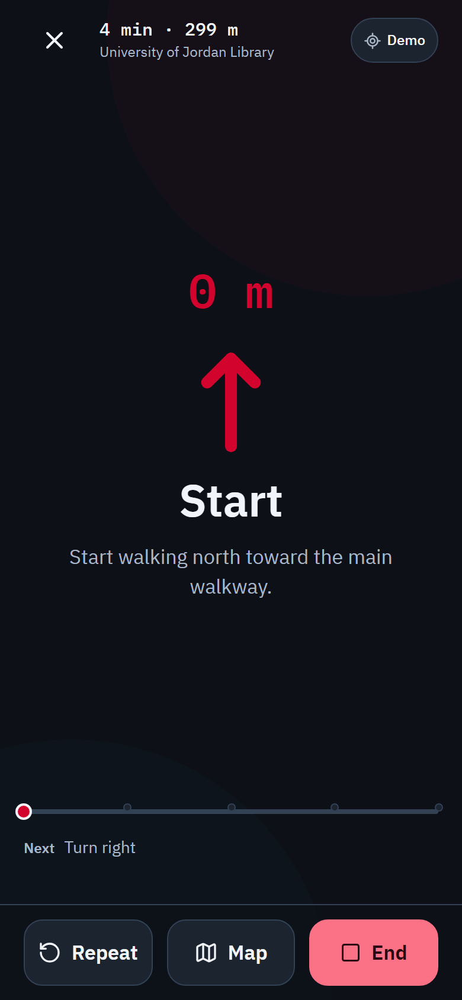 | 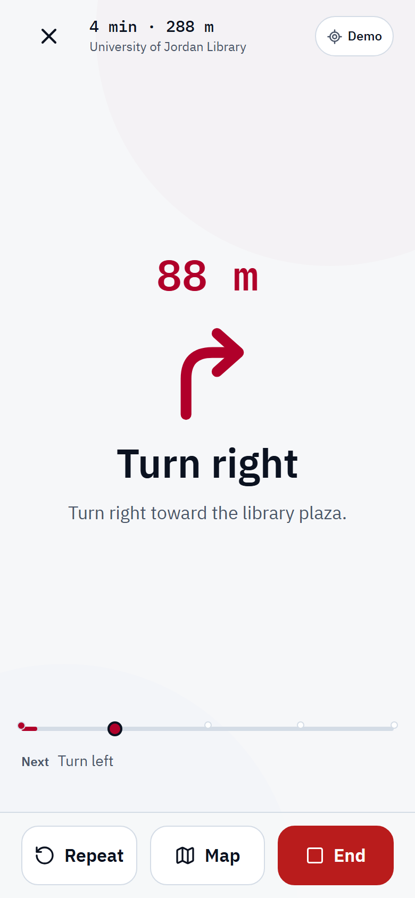 | 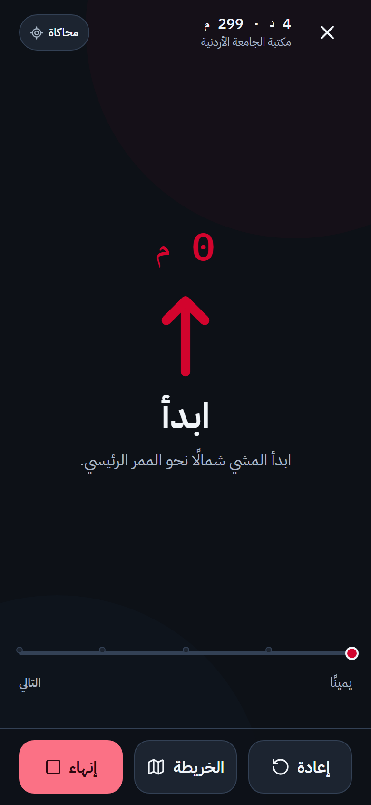 |

| Planning | Route sheet | Converse |
|---|---|---|
| 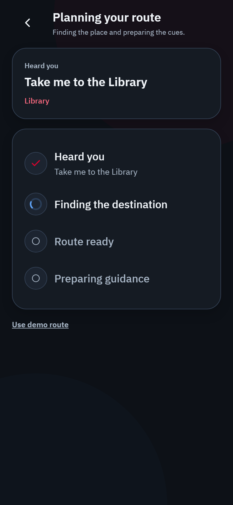 | 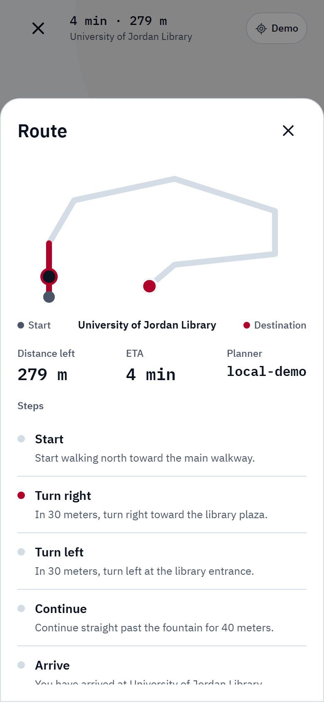 | 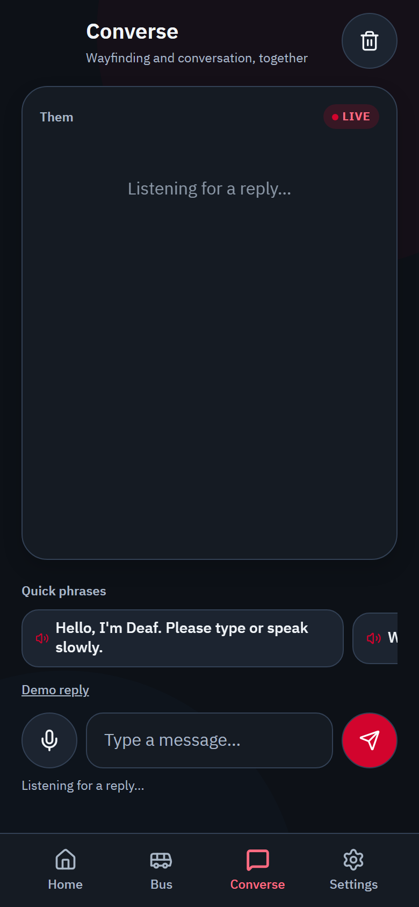 |

| Settings — Night | Settings — Day |
|---|---|
| 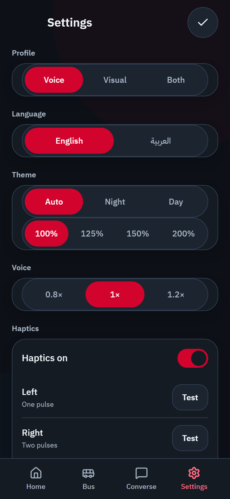 | 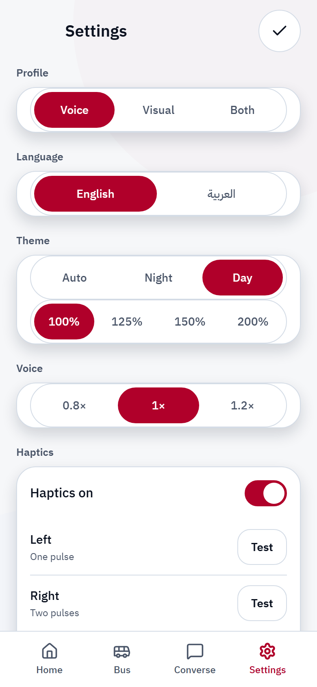 |

| Onboarding |
|---|
| 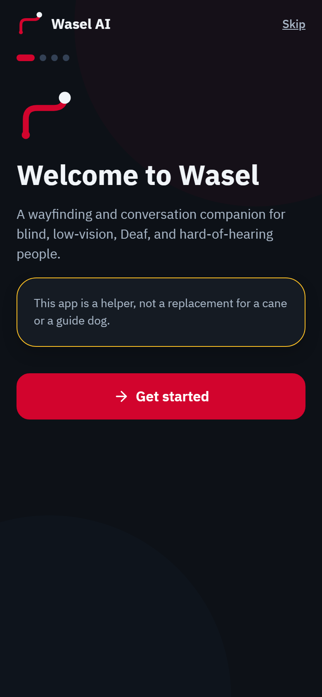 |

| Bus — English | Bus — Arabic |
|---|---|
| 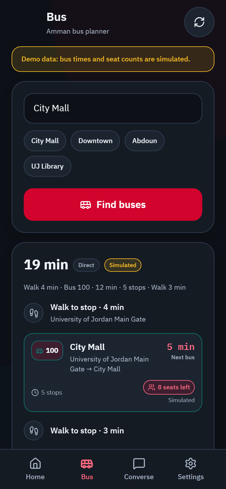 | 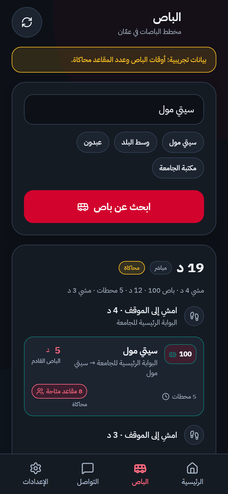 |

## Anti-patterns

- A dense dashboard while walking.
- A map as the primary guidance surface.
- Color-only direction cues.
- Icon-only buttons without labels.
- Animated backgrounds, parallax, or looping pulses.
- Glass on the instruction card.
- 14px body text.
- A theme editor in Phase 0.
- Copying Kiro's brand assets.
